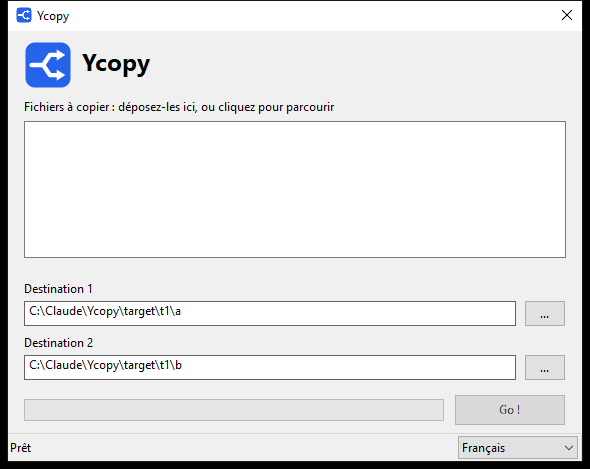

# Ycopy

**Copy files to two destinations at once, reading each source file only once.**

Ycopy is a small native Windows tool written in Rust (edition 2024). Drop some files on the window, pick two destination folders, press **Go!**: every file is read a single time from the source and each chunk is written to both destinations. Handy when you back up the same files to two disks, or copy from a slow source (SD card, network share, old HDD) to two targets.



## Features

- **Single read, two writes** – each source file is read once, in 4 MiB chunks, and every chunk goes to both destinations. Memory use stays constant whatever the file size.
- **Native Win32 dialog** – no web view, no runtime; the release executable is about 600 KB.
- **Drag & drop or browse** – drop files on the list, or click it to open a multi-selection file picker.
- **Progress feedback** – progress bar, remaining time and copy speed (MB/s) in the status bar. Files disappear from the list as they are copied.
- **Command-line mode** – the same executable copies without opening a window when you pass files as arguments.
- **Multilingual** – English, French, German, Spanish, Italian and Portuguese, with a language selector in the status bar. Adding a language is a matter of adding one text file.
- **Safe by design** – a file cannot be copied onto itself, partial copies are removed on error or cancellation, and file modification times are preserved.

## Requirements

- Windows 10 or later (x64).
- To build: a recent stable Rust toolchain (MSVC target) and the Windows SDK, whose `rc.exe` is used to embed the icon and the manifest.

## Build

```bash
cargo build --release
```

The executable is `target/release/ycopy.exe`.

Run the tests with:

```bash
cargo test
```

The icon (`assets/ycopy.ico`) is generated by a dependency-free example, only needed if you want to change the design:

```bash
rustc --edition 2024 -O examples/make_icon.rs -o target/make_icon.exe
target\make_icon.exe
```

## Usage

### Graphical interface

Run `ycopy.exe` without file arguments.

1. Choose **Destination 1** and **Destination 2** (type a path or use the `...` buttons). They must be different folders; missing folders are created.
2. Drop files on the list, or click the list to browse. Folders are ignored.
3. Press **Go!** (enabled once both destinations are set).

Files are copied one after the other. A file that fails is reported at the end and stays in the list so you can retry. Closing the window during a copy cancels it cleanly.

### Command line

```text
ycopy [OPTIONS] [FILE...]

  --dest1 DIR    first destination folder
  --dest2 DIR    second destination folder
  --lang CODE    interface language (en, fr, de, es, it, pt)
  -h, --help     show this help
  -V, --version  show the version
```

Examples:

```bash
# Copy two files to two folders, no window
ycopy report.pdf photo.jpg --dest1 D:\Backup --dest2 E:\Backup

# Open the window with the destinations pre-filled, in German
ycopy --dest1 D:\Backup --dest2 E:\Backup --lang de
```

Exit codes: `0` success, `1` at least one file failed, `2` invalid usage.

> The executable uses the Windows GUI subsystem, so when started from a terminal the prompt may come back before the copy has finished. Progress and messages are still printed to the console.

### Language

The language is chosen, in this order, from:

1. `--lang CODE`
2. the `YCOPY_LANG` environment variable
3. the Windows user locale
4. English, as a fallback

The selector in the status bar changes the language immediately. The choice is **deliberately not saved**: the next launch starts again from the rules above.

## Project layout

```text
src/
  main.rs      entry point: GUI or command line
  lib.rs       shared helpers
  copier.rs    copy engine (no UI, no translation dependency)
  gui.rs       main dialog (native-windows-gui)
  cli.rs       argument parsing and command-line run
  i18n.rs      translations loaded from locales/*.txt
  format.rs    duration / speed formatting
  platform.rs  the few Win32 calls used outside the GUI toolkit
locales/       en, fr, de, es, it, pt (key = value files)
assets/        icon, manifest and resource script
examples/      icon generator
doc/           screenshot and AI-assisted development log
```

### Adding a language

1. Copy `locales/en.txt` to `locales/<code>.txt` and translate the values (keep the keys and the `{0}`, `{1}` placeholders).
2. Add the variant to `Lang` in `src/i18n.rs` (code, native name, `include_str!`).

A unit test fails if a language is missing a key or has a different set of placeholders than English.

## Design notes

- The reported speed is the **source read throughput**: each byte read is written twice, so the amount written is double.
- The remaining time is the average speed since the start applied to the bytes left.
- If two source files share the same name, the later one overwrites the earlier one in the destinations. Existing files in the destinations are overwritten without asking.
- Dependencies are kept to a minimum: `native-windows-gui` and `windows-sys` at run time, `embed-resource` at build time.

## Limitations

- Windows only.
- Dropped folders are ignored (no recursive copy yet).
- No cancel button; closing the window cancels the copy.

## License

Ycopy is free software, released under the [GNU General Public License v3.0](LICENSE).
